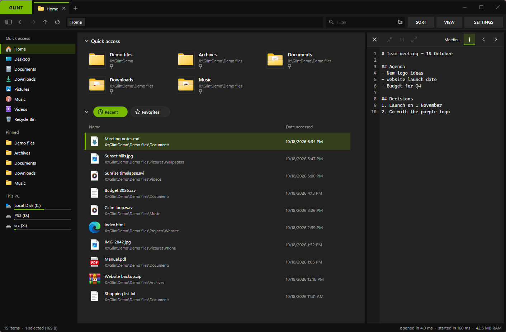
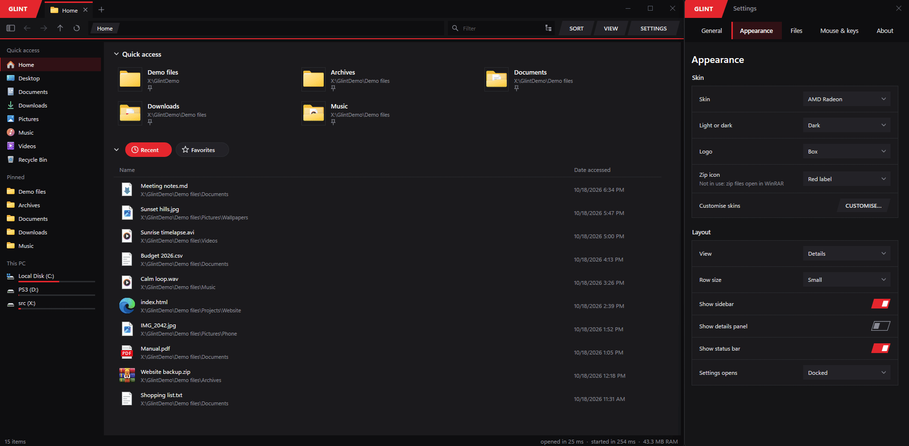
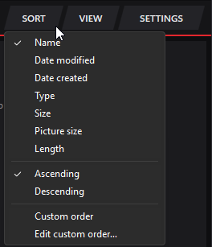
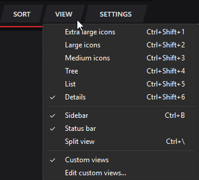
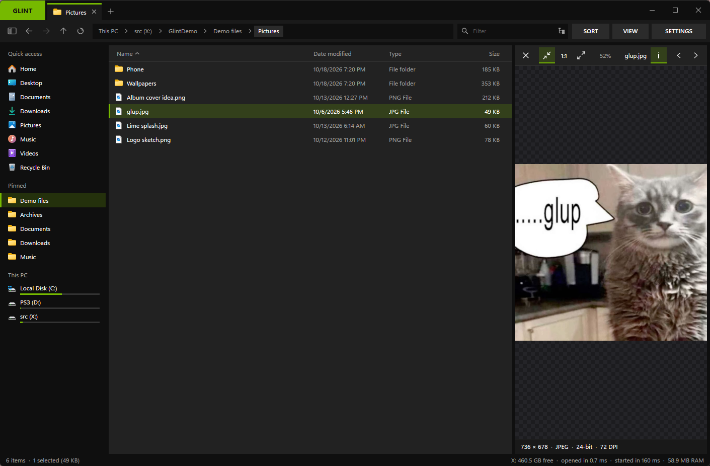
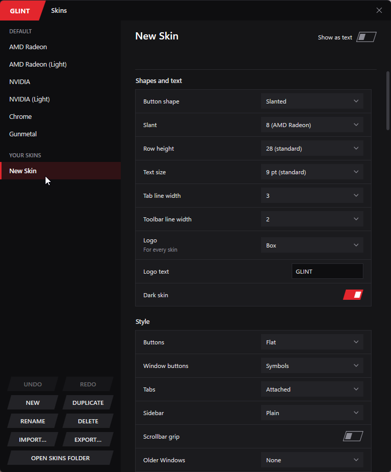
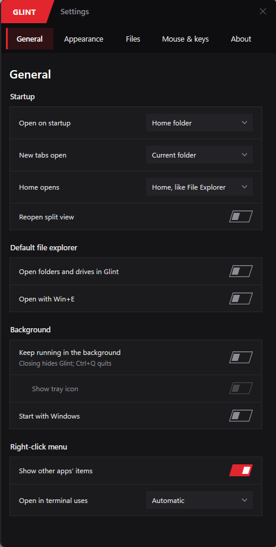
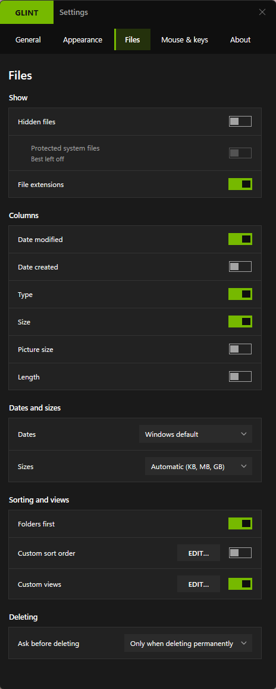
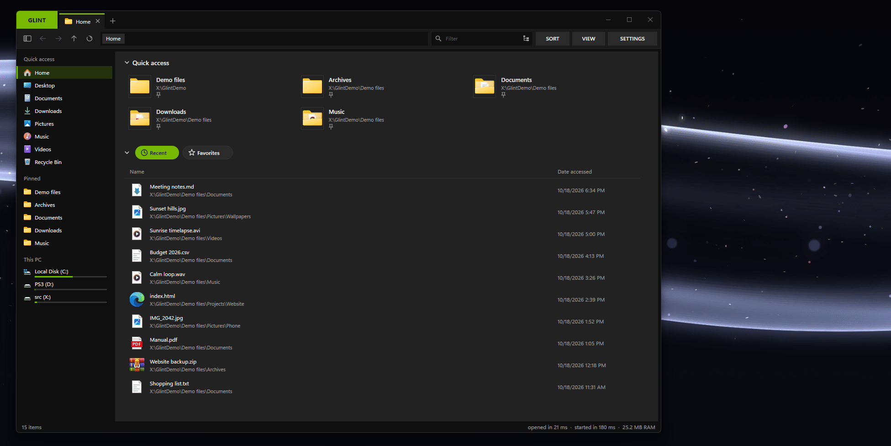

# Glint

A fast, small file explorer for Windows 10 and 11.
Tabs, split view, previews and skins, all in one `Glint.exe` of a few megabytes.
Nothing to install, and it opens instantly.

**[Download Glint.exe](https://github.com/npr-tami/glint/releases/latest)** · [What's new](CHANGELOG.md) · [Report a bug](https://github.com/npr-tami/glint/issues)

> Glint is in beta and made by one person for fun. I use it every day, but expect rough edges.

<p align="center">
  
</p>

**On this page:** [Features](#features) · [Screenshots](#screenshots) · [Get started](#get-started) ·
[Shortcuts](#keyboard-shortcuts) · [Default file explorer](#make-glint-your-default-file-explorer) ·
[Settings files](#where-glint-keeps-its-settings) · [Build it yourself](#build-it-yourself)

## Features

### Getting around

- **Tabs**, with pinned tabs and saved tab sets.
- **Split view**: two folders side by side (Ctrl+\\).
- **Sidebar** with Quick access, pinned folders and your drives.
- **Path bar** you can click or type into.
- **Home** with your folders, recent files and Favorites.
- **Command box** (Ctrl+U): type a command, a setting, a folder or a search word.

### Seeing your files

- **Views**: icons with thumbnails, list, details and a tree.
- **Preview** pictures, GIFs, videos and text with Space.
- **Details panel** (Alt+P).
- **Folder sizes** and **colour tags**.
- **Zip and 7z** files open like folders.

### Working with files

- Copy, move, rename and delete the Windows way, so the Recycle Bin still works.
- **Undo and redo** (Ctrl+Z, Ctrl+Y).
- **Copy queue** you can pause.
- **Filter as you type**, in subfolders too, or across all your drives.
- **Rename many** (F2 with several files selected).
- **Find duplicates** (right-click empty space).

### Making it yours

- **Skins**: AMD Radeon, NVIDIA, Chrome and Gunmetal, with light versions.
- **Skin customiser** to make your own, even with a wallpaper.
- **Your own sort order and views** per folder: [how it works](docs/sort-order.md).
- **Default file explorer**, if you want: folders, drives and Win+E open in Glint.
- **Background mode**: Glint waits in the tray, so new windows open instantly.
- **Updates itself** when you say so.

## Screenshots

<p align="center">
   Appearance: AMD Radeon, NVIDIA, their light versions, Chrome and Gunmetal">
  <br><sub>Switching skins in <b>Settings > Appearance</b></sub>
</p>

<table>
  <tr>
    <td align="center" valign="top" width="50%">
      <br><sub>SORT menu</sub>
    </td>
    <td align="center" valign="top" width="50%">
      <br><sub>VIEW menu</sub>
    </td>
  </tr>
</table>

<p align="center">
  
  <br><sub>Space preview</sub>
</p>

<table>
  <tr>
    <td align="center" valign="top">
      <br><sub>Skin customiser</sub>
    </td>
    <td align="center" valign="top">
       General"><br><sub>Settings > General</sub>
    </td>
    <td align="center" valign="top">
       Files"><br><sub>Settings > Files</sub>
    </td>
  </tr>
</table>

<details>
<summary>A quick tour of Settings (GIF, 5 MB)</summary>
<p align="center">
  
</p>
</details>

## Get started

1. Download `Glint.exe` from the [latest release](https://github.com/npr-tami/glint/releases/latest).
2. Put it in a folder of its own.
3. Double-click it.

**"Windows protected your PC"?** Glint is new and not signed, so Windows asks first.
Click **More info**, then **Run anyway**.

**Going online:** Glint only checks GitHub for updates. You can turn that off in **Settings > About**.

**Portable:** turn on **Settings > About > Portable**. Glint then keeps everything next to
`Glint.exe`, so it can live on a USB stick.

**To remove Glint:**
1. If you made Glint your default file explorer, turn that off first.
2. Delete `Glint.exe`.
3. Delete the `%APPDATA%\Glint` folder.

## Keyboard shortcuts

The ones you'll use most:

| Keys | What they do |
|---|---|
| Ctrl+T, Ctrl+W | New tab, close tab |
| Space | Preview |
| Ctrl+F | Filter |
| Ctrl+Z, Ctrl+Y | Undo, redo |
| Ctrl+U | Command box |
| Ctrl+, | Settings |

<details>
<summary>All shortcuts</summary>

| Keys | What they do |
|---|---|
| Ctrl+T, Ctrl+W, Ctrl+Shift+T | New tab, close tab, reopen closed tab |
| Ctrl+Tab, Ctrl+Shift+Tab, Ctrl+1…9 | Next tab, previous tab, go to a tab |
| Alt+Left / Alt+Right, Alt+Up, Backspace | Back / forward, up a folder |
| Ctrl+L (or F4, Alt+D) | Type a path |
| Ctrl+F (or F3), Ctrl+Shift+F | Filter, search subfolders too |
| Ctrl+C, Ctrl+X, Ctrl+V, Ctrl+A | Copy, cut, paste, select all |
| Ctrl+Z, Ctrl+Y | Undo, redo |
| Del, Shift+Del, F2 | Delete, delete for good, rename |
| Ctrl+Shift+N | New folder |
| Ctrl+Shift+C | Copy the selected paths as text |
| F5 (or Ctrl+R), Alt+Enter | Refresh, Properties |
| Space, Alt+P | Preview, details panel |
| Ctrl+Shift+1…6 | Views: extra large, large, medium icons, tree, list, details |
| Ctrl+B, Ctrl+D, Ctrl+H | Sidebar, pin the folder, hidden files |
| Ctrl+Shift+L | Switch between the skin's light and dark versions |
| Ctrl+` | Open a terminal here |
| Ctrl+\\, F6 | Split view, go to the other side |
| Shift+right-click | Windows' full right-click menu |
| Ctrl+U | Command box |
| Ctrl+N, Ctrl+Q | New window, quit Glint |
| Ctrl+, | Settings |

</details>

## Make Glint your default file explorer

This is optional.

**To switch it on:** go to **Settings > General** and turn on **Open folders and drives in Glint**.
Turn on **Open with Win+E** too, if you like.

**What changes:** folders and drives you double-click open in Glint.
Control Panel, phones and similar still open in File Explorer.
Only your own Windows account is changed, and no admin rights are needed.

**Keep Glint.exe where it is.** If you move it, start it once from the new place.
It can't be switched on from a USB stick, a network drive or straight from inside a zip.

**To switch it off:** turn the same settings off. Whatever was there before comes back.

<details>
<summary>If Glint won't start or is gone</summary>

If Glint.exe is still there, run this in a command prompt. It gives folders, drives and Win+E back
to File Explorer:

```
glint.exe --restore-explorer
```

If Glint.exe is gone, press Win+R, type `cmd`, press Enter, and paste these lines.
They only remove Glint's own entries, for your account.

```
reg delete "HKCU\Software\Classes\Directory\shell\glint" /f
reg delete "HKCU\Software\Classes\Drive\shell\glint" /f
reg query "HKCU\Software\Classes\Directory\shell" /ve | find /i "glint" && reg delete "HKCU\Software\Classes\Directory\shell" /ve /f
reg query "HKCU\Software\Classes\Drive\shell" /ve | find /i "glint" && reg delete "HKCU\Software\Classes\Drive\shell" /ve /f
reg query "HKCU\Software\Classes\CLSID\{52205fd8-5dfb-447d-801a-d0b52f2e83e1}\shell\opennewwindow\command" /v GlintOwned && reg delete "HKCU\Software\Classes\CLSID\{52205fd8-5dfb-447d-801a-d0b52f2e83e1}\shell\opennewwindow" /f
```

Folders then open in File Explorer again.

</details>

## Where Glint keeps its settings

Everything is in one folder: `%APPDATA%\Glint`.
When portable, it's the `Glint data` folder next to Glint.exe.

| What | Folder inside it |
|---|---|
| Settings and your skins | `config` |
| Cache | `cache` |
| Error log | `logs` |

**Settings > About** has buttons to open these folders.

## Build it yourself

<details>
<summary>How to build Glint from the source</summary>

1. Install Rust from [rustup.rs](https://rustup.rs) with the default (MSVC) toolchain.
2. Install the [Visual Studio Build Tools](https://visualstudio.microsoft.com/visual-cpp-build-tools/)
   with **"Desktop development with C++"**.
3. Build:

   ```
   git clone https://github.com/npr-tami/glint
   cd glint
   cargo build --release
   ```

4. The program is `target\release\glint.exe`.

Cross-compiling from Linux works too, with mingw-w64 installed:

```
rustup target add x86_64-pc-windows-gnu
cargo build --release --target x86_64-pc-windows-gnu
```

</details>

## Bugs and ideas

Welcome in [Issues](https://github.com/npr-tami/glint/issues).

## License

[MIT](LICENSE). Glint isn't connected to AMD, NVIDIA or Google. Some skins are just inspired by
their looks.
