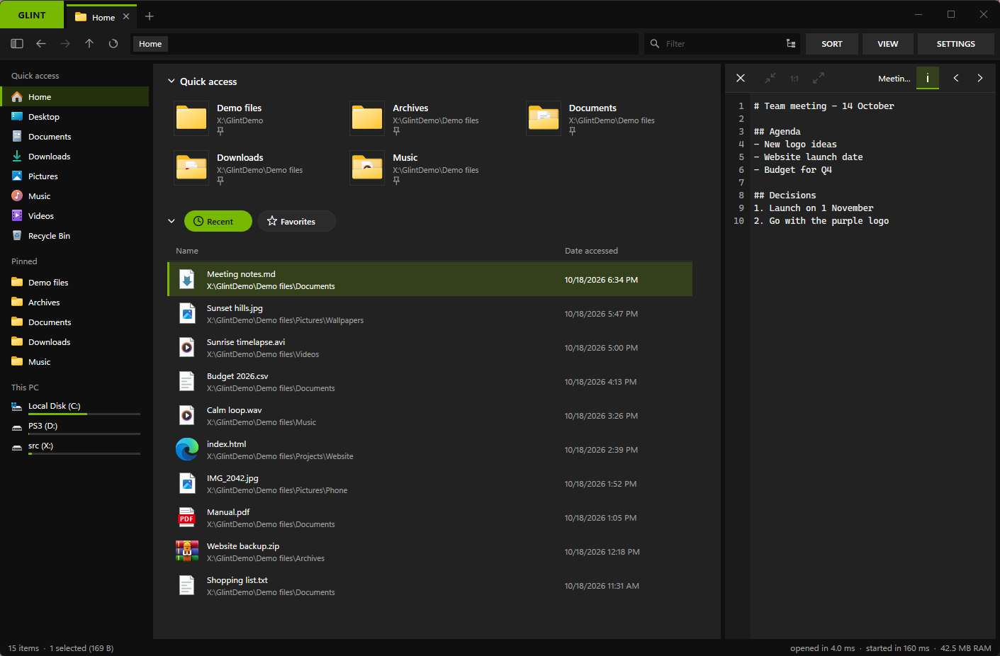
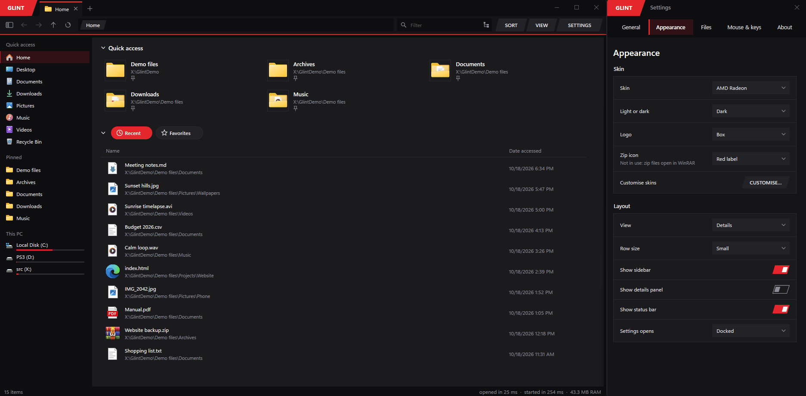
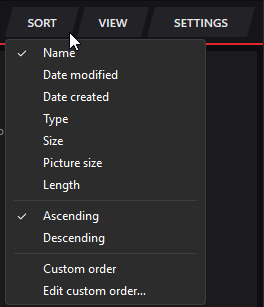
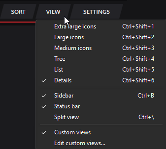
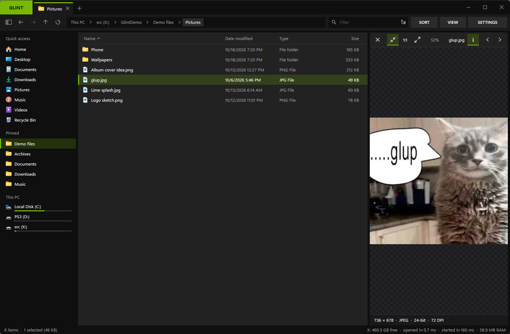
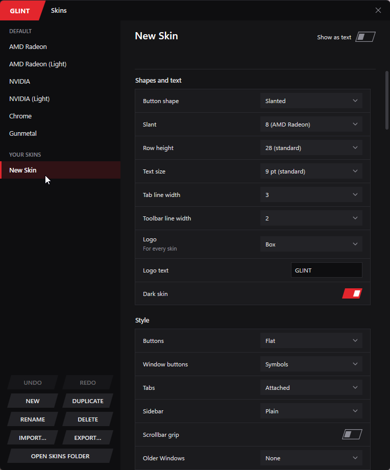
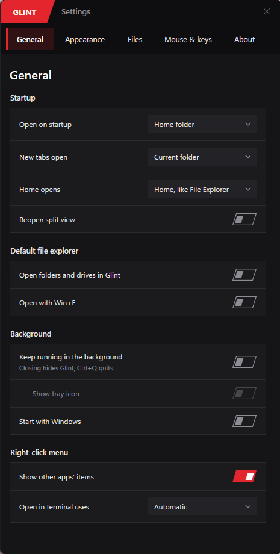
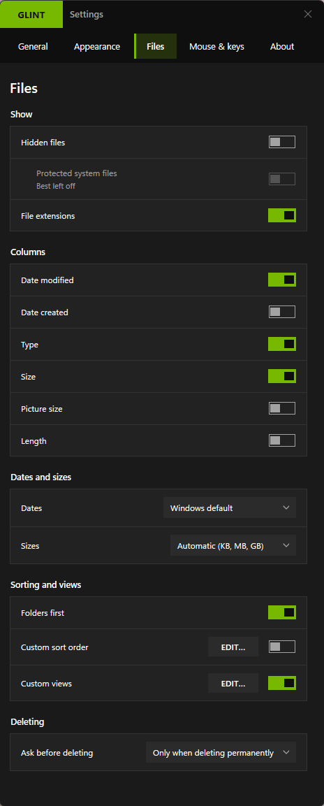
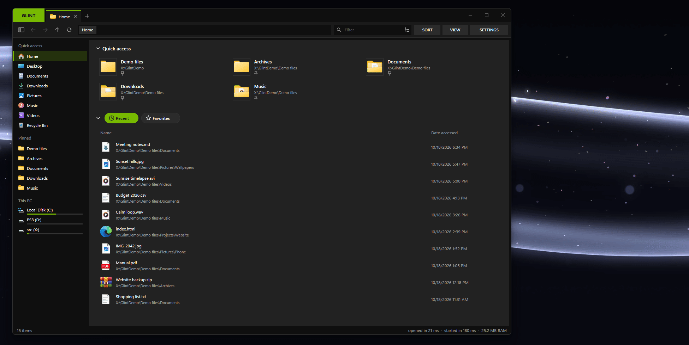

# Glint

A fast, lightweight file explorer for Windows 10 and 11.
Tabs, split view, previews and skins in a single `Glint.exe` of a few megabytes.
No installer, and it starts instantly.

[](https://github.com/npr-tami/glint/releases/latest)
[](https://github.com/npr-tami/glint/releases)
[](LICENSE)

**[Download Glint.exe](https://github.com/npr-tami/glint/releases/latest)** · [Changelog](CHANGELOG.md) · [Report a bug](https://github.com/npr-tami/glint/issues)

<p align="center">
  
</p>

**Contents:** [Features](#features) · [Screenshots](#screenshots) · [Installation](#installation) ·
[Keyboard shortcuts](#keyboard-shortcuts) · [Default file explorer](#default-file-explorer) ·
[Settings and data](#settings-and-data) · [Building from source](#building-from-source)

## Features

### Navigation

- **Tabs**, with pinned tabs and saved tab sets
- **Split view** to show two folders side by side
- **Sidebar** with Quick access, pinned folders and drives
- **Path bar** you can click or type into
- **Home** with your folders, recent files and Favourites
- **Command box** for commands, settings, folders and searches

### Viewing files

- **Views**: icons with thumbnails, list, details and tree
- **Preview** for pictures, GIFs, videos, text, code and PDFs
- **Details panel**
- **Folder sizes** and **colour tags**
- **Disk space**: the biggest folders, what changed and space by type

### File management

- **Copy, move, rename and delete** through Windows, so the Recycle Bin works as usual
- **Drag and drop** between Glint, File Explorer and other apps
- **Recycle Bin** with restore
- **Undo and redo** for file operations
- **Copy queue** with pause and cancel
- **Search bar** for this folder, its subfolders, every drive (from This PC) or text inside files
- **Zip and 7z** files open like folders, and can be edited, extracted or created
- **Rename all**: rename many files at once (F2 with several selected)
- **Find duplicates**, then select the extra copies

### Customisation

- **Skins**: AMD Radeon and NVIDIA, each with a light version, plus Chrome and Gunmetal
- **Skins window** to make your own skins, with an optional wallpaper
- **Folder rules**: a sort order and view for each folder ([guide](docs/sort-order.md))
- **Keyboard shortcuts** you can change

### Windows

- **Default file explorer** for folders, drives and Win+E (optional)
- **Background mode**: Glint stays in the tray, so new windows open instantly
- **Automatic updates** from GitHub, if you turn them on

## Screenshots

<p align="center">
   Appearance: AMD Radeon, NVIDIA, their light versions, Chrome and Gunmetal">
  <br><sub>Switching skins in <b>Settings > Appearance</b></sub>
</p>

<table>
  <tr>
    <td align="center" valign="top" width="50%">
      <br><sub>SORT menu</sub>
    </td>
    <td align="center" valign="top" width="50%">
      <br><sub>VIEW menu</sub>
    </td>
  </tr>
</table>

<p align="center">
  
  <br><sub>Preview</sub>
</p>

<table>
  <tr>
    <td align="center" valign="top">
      <br><sub>Skins window</sub>
    </td>
    <td align="center" valign="top">
       General"><br><sub>Settings > General</sub>
    </td>
    <td align="center" valign="top">
       Files"><br><sub>Settings > Files</sub>
    </td>
  </tr>
</table>

<details>
<summary>Settings tour (GIF, 5 MB)</summary>
<p align="center">
  
</p>
</details>

## Installation

Requires Windows 10 or 11, 64-bit.

1. Download `Glint.exe` from the [latest release](https://github.com/npr-tami/glint/releases/latest).
2. Put it in a folder of its own.
3. Run it.

**SmartScreen:** Glint isn't code-signed, so Windows may show "Windows protected your PC".
Click **More info**, then **Run anyway**.

**Network:** Glint only goes online to check GitHub for updates and download them. To stop this,
turn off **Check for updates automatically** in **Settings > About**.

**Portable mode:** turn on **Settings > About > Portable mode** to keep all of Glint's files next to
`Glint.exe`, for example on a USB stick.

### Uninstalling

1. In **Settings > General**, turn off **Open folders and drives in Glint**, **Win+E opens Glint** and
   **Start with Windows**.
2. Delete `Glint.exe`.
3. Delete the `%APPDATA%\Glint` folder, or the `Glint data` folder in portable mode.

## Keyboard shortcuts

These are the most common shortcuts. You can change most of them in **Settings > Keyboard shortcuts**.

| Shortcut | Action |
|---|---|
| Ctrl+T / Ctrl+W | New tab / Close tab |
| Space | Preview |
| Ctrl+F | Search bar |
| Ctrl+Z / Ctrl+Y | Undo / Redo |
| Ctrl+U | Command box |
| Ctrl+, | Settings |

<details>
<summary>All shortcuts</summary>

| Shortcut | Action |
|---|---|
| Ctrl+T / Ctrl+W / Ctrl+Shift+T | New tab / Close tab / Reopen closed tab |
| Ctrl+Tab / Ctrl+Shift+Tab | Next tab / Previous tab |
| Ctrl+1 to 9 | Go to tab 1 to 9 |
| Ctrl+N | New window |
| Ctrl+\\ / F6 | Split view / Switch pane |
| Ctrl+L (or F4 or Alt+D) | Type a path |
| Ctrl+F (or F3) / Ctrl+Shift+F | Search bar / Search subfolders |
| Alt+Left / Alt+Right | Back / Forward |
| Alt+Up (or Backspace) | Go up |
| F5 (or Ctrl+R) | Refresh |
| Ctrl+D | Pin to sidebar |
| Ctrl+` | Open in terminal |
| Ctrl+Shift+U | Disk space |
| Ctrl+Enter | Open in new tab |
| F2 | Rename |
| Ctrl+C / Ctrl+X / Ctrl+V | Copy / Cut / Paste |
| Ctrl+Shift+C | Copy path |
| Delete / Shift+Delete | Delete / Delete permanently |
| Ctrl+Shift+N | New folder |
| Ctrl+Z / Ctrl+Y | Undo / Redo |
| Ctrl+A | Select all |
| Alt+Enter | Properties |
| Space | Preview |
| Ctrl+Shift+1 to 6 | Change view |
| Ctrl+B | Show or hide sidebar |
| Alt+P | Show or hide details panel |
| Ctrl+H | Show or hide hidden files |
| Ctrl+Shift+L | Light or dark mode |
| Ctrl+U | Command box |
| Ctrl+, | Settings |
| Ctrl+Q | Exit Glint |
| Shift+right-click | Full right-click menu |

Ctrl+1 to 9, Ctrl+Shift+1 to 6 and Shift+right-click can't be changed.
Backspace goes up a folder, or back if you choose that in **Settings > Keyboard shortcuts**.

</details>

## Default file explorer

If you like, Glint can open folders and drives instead of File Explorer.

**Turn it on:** in **Settings > General**, turn on **Open folders and drives in Glint**, and
**Win+E opens Glint** if you want that too.

**What changes:** folders and drives open in Glint. Control Panel, phones and similar items still
open in File Explorer. Only your own Windows account is changed, and no admin rights are needed.

**Moving Glint:** if you move `Glint.exe`, run it once from the new location. This can't be turned
on when Glint runs from a USB stick, a network drive or a zip file.

**Turn it off:** turn the same settings off. Your previous setup comes back.

<details>
<summary>If Glint won't start or has been deleted</summary>

If `Glint.exe` is still there, run this in a command prompt to give folders, drives and Win+E back
to File Explorer:

```
Glint.exe --restore-explorer
```

If `Glint.exe` is gone, press Win+R, type `cmd`, press Enter and paste these lines.
They only remove Glint's own entries, for your account.

```
reg delete "HKCU\Software\Classes\Directory\shell\glint" /f
reg delete "HKCU\Software\Classes\Drive\shell\glint" /f
reg query "HKCU\Software\Classes\Directory\shell" /ve | find /i "glint" && reg delete "HKCU\Software\Classes\Directory\shell" /ve /f
reg query "HKCU\Software\Classes\Drive\shell" /ve | find /i "glint" && reg delete "HKCU\Software\Classes\Drive\shell" /ve /f
reg query "HKCU\Software\Classes\CLSID\{52205fd8-5dfb-447d-801a-d0b52f2e83e1}\shell\opennewwindow\command" /v GlintOwned && reg delete "HKCU\Software\Classes\CLSID\{52205fd8-5dfb-447d-801a-d0b52f2e83e1}\shell\opennewwindow" /f
```

Folders then open in File Explorer again.

</details>

## Settings and data

Glint keeps everything in `%APPDATA%\Glint`, or in the `Glint data` folder next to `Glint.exe` in
portable mode.

| Folder | Contents |
|---|---|
| `config` | Settings, your skins, colour tags and Disk space scans |
| `cache` | Search indexes and downloaded updates, safe to clear |
| `logs` | Error log |

**Settings > About** has buttons to open the settings and log folders, and to clear the cache.

## Building from source

<details>
<summary>Build steps</summary>

1. Install Rust from [rustup.rs](https://rustup.rs) with the default (MSVC) toolchain.
2. Install the [Visual Studio Build Tools](https://visualstudio.microsoft.com/visual-cpp-build-tools/)
   with **Desktop development with C++**.
3. Build:

   ```
   git clone https://github.com/npr-tami/glint
   cd glint
   cargo build --release
   ```

4. You'll find the program at `target\release\glint.exe`.

To cross-compile from Linux, install mingw-w64, then:

```
rustup target add x86_64-pc-windows-gnu
cargo build --release --target x86_64-pc-windows-gnu
```

</details>

## Feedback

Bug reports and ideas are welcome in [Issues](https://github.com/npr-tami/glint/issues).

## Licence

[MIT](LICENSE). Glint is not affiliated with AMD, NVIDIA or Google. Some skins are inspired by
their designs.
